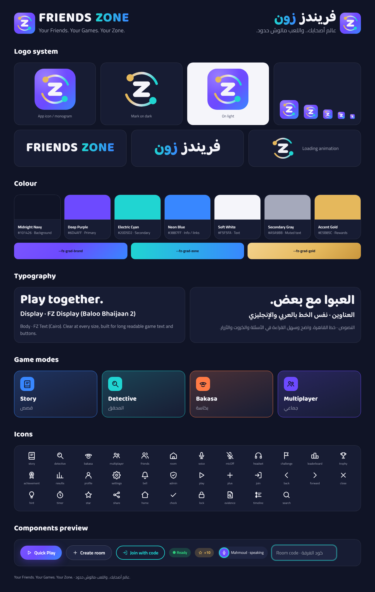

# FRIENDS ZONE — Brand guide (Phase 2)

**Name** FRIENDS ZONE · فريندز زون · short **FZ**
**Tagline** Your Friends. Your Games. Your Zone. · عالم أصحابك.. واللعب مالوش حدود.

## The mark
Two friends (gold and cyan dots) each hold half of the **zone** ring; the white **Z** is the path that connects them.
It reads as a Z at 16 px (the small variant drops the ring), as "two players in one shared space" at app-icon size,
and the two half-rings orbit in the loading animation. Built on a 512 grid in `src/brand/Logo.tsx` (React) and
`scripts/brand/mark.mjs` (static assets) — keep both in sync.

Variants: tile (app icon / monogram), bare mark, mono white, small (favicon), horizontal EN / AR lockups (+ tagline),
stacked bilingual, profile avatar, OG share image, loader (`FzLoader`). Minimum size 16 px (small variant); clear space = ¼ of the mark.
Do not recolour the friends, rotate the mark, or put it on busy photos without the tile.

## Colour
| Token | Hex | Use |
|---|---|---|
| `--fz-navy` | #101426 | App background |
| `--fz-purple` | #6D4AFF | Primary actions, brand |
| `--fz-cyan` | #20D5D2 | Secondary, focus ring, "zone" |
| `--fz-blue` | #3887FF | Info, links, gradient end |
| `--fz-white` | #F5F5FA | Text on dark |
| `--fz-gray` | #A5A9BB | Muted text |
| `--fz-gold` | #E5B85C | Points, rewards, winners |
Surfaces `--fz-surface-1/2/3`, status `--fz-success/warning/danger`, mode accents `--fz-mode-story/detective/bakasa/multiplayer`.
Gradients (`--fz-grad-brand/zone/gold`) only on primary buttons, the wordmark "ZONE", and reward moments.

## Type
Display: **FZ Display** = Baloo Bhaijaan 2 (600/800) — one family for Arabic and Latin headings.
Text: **FZ Text** = Cairo (400/600/700). Both self-hosted from `public/fonts` (OFL-1.1, ~175 KB total, unicode-range split).

## Icons
`src/brand/icons.tsx`: 34 icons, 24 px grid, 2 px round stroke, `currentColor`; directional icons mirror in RTL.
Emoji are no longer primary icons in redesigned screens.

## Assets
`node scripts/brand/generate-assets.mjs` renders 40 images into `brand-assets/` (favicons, PWA 192/512/maskable,
Apple touch, Android launcher legacy/round/adaptive-foreground for every density, portrait/landscape splash for every
density, logos, social avatar, OG image, pattern). PNGs were palette-compressed (8.7 MB → 0.8 MB).
Phase 3 copies them into `public/` and `android/app/src/main/res/` together with the name change.
